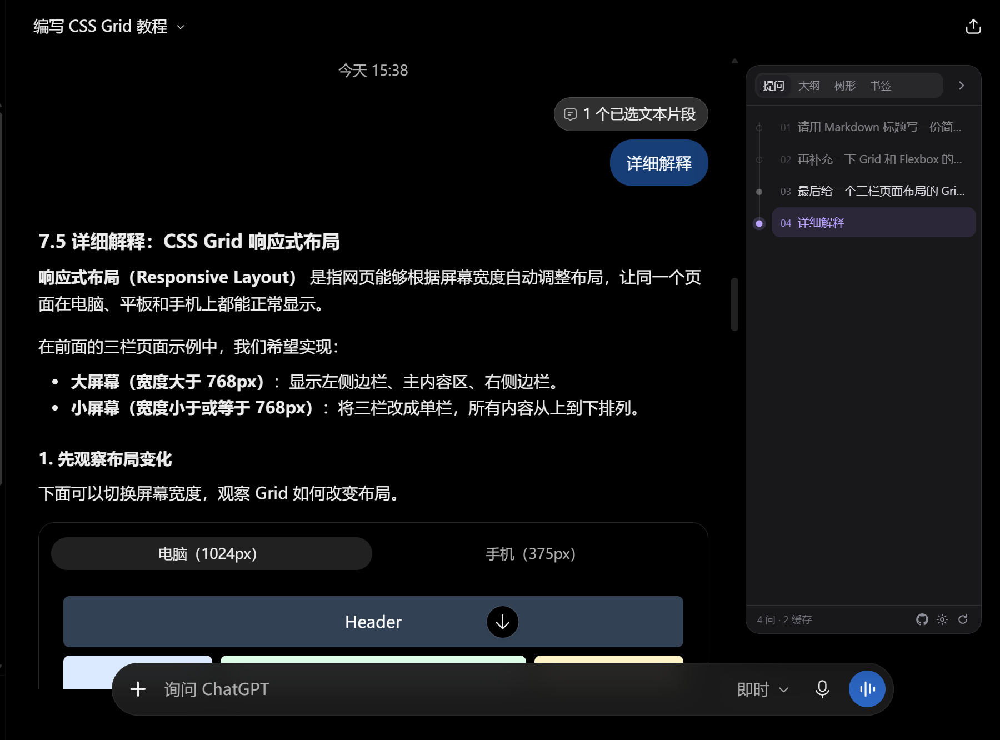
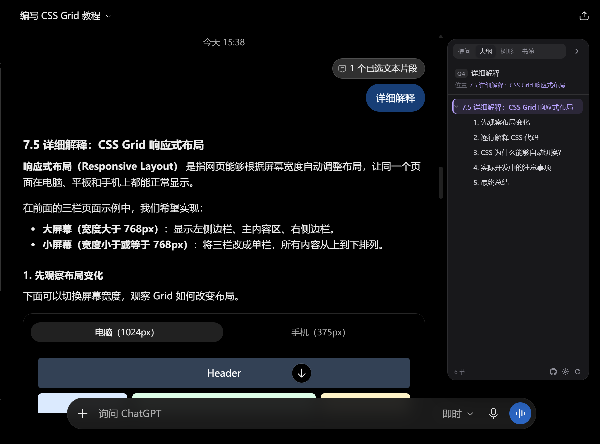
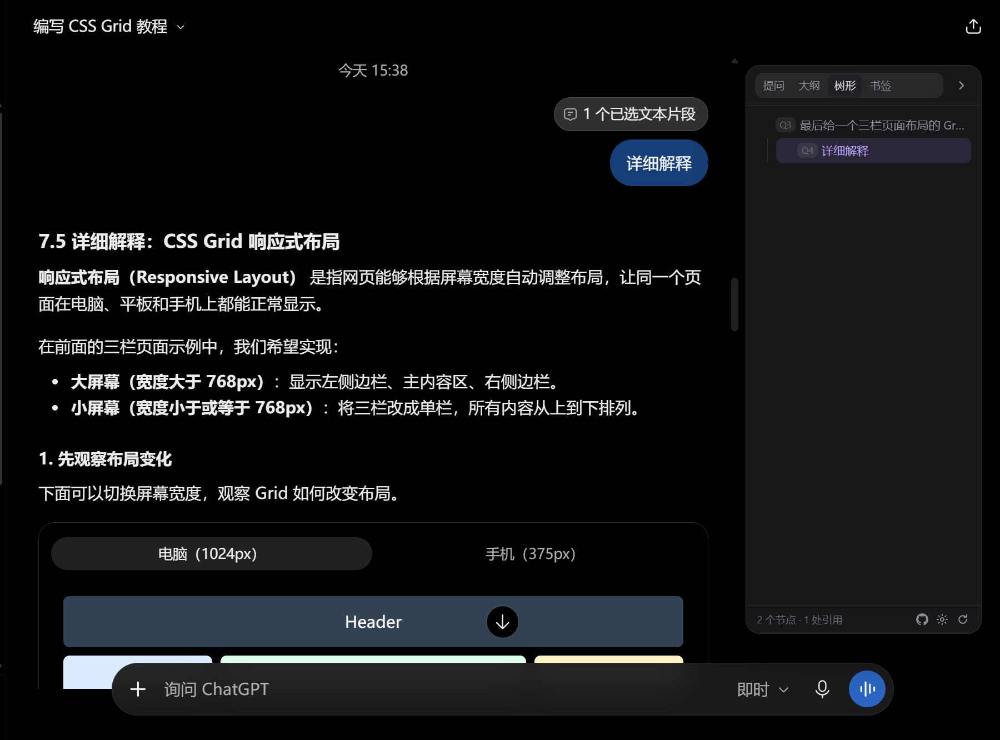
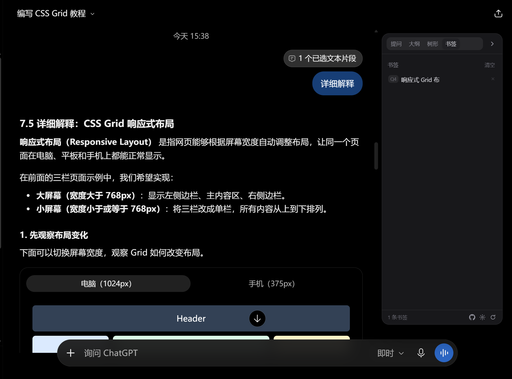
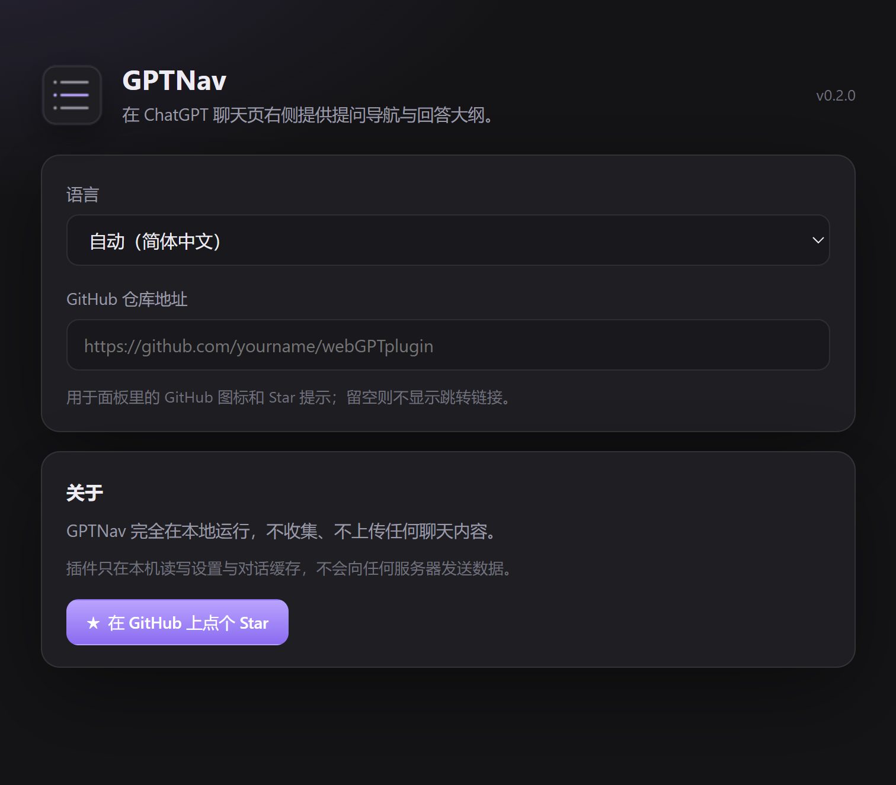

# GPTNav · ChatGPT 导航轨

**给 ChatGPT 网页版加一条右侧导航栏：提问导航 + 可折叠的 Markdown 大纲 + 引用树 + 书签。**
长对话里不用再往上翻半天——点提问直接跳，点标题直接定位，引用关系一眼看清，选中的文字随手收藏。

> A prompt navigator, collapsible Markdown outline, quote tree and bookmark sidebar for ChatGPT. Works in Edge and Chrome.

[下载最新版](https://github.com/AblazeGHR/webGPTplugin/releases/latest) · [安装（开发者模式）](#安装开发者模式) · [隐私政策](PRIVACY.md)



## 为什么用它

- **长对话不再迷路**：课程答疑、代码讨论、连续追问、研究报告，随时跳回某条提问
- **回答有结构**：自动提取 `h1–h6`，按层级折叠，当前章节紫色高亮，面包屑显示“位置”
- **引用关系一眼看清**：引用提问自动生成父子树；同一父节点可挂多个子节点，多个子节点可折叠
- **书签**：选中正文文字即可保存摘录，点击书签跳回原文并高亮
- **适配懒加载**：GPT 会向上、向下双向懒加载；点击未加载条目会逐批定位，不丢条目
- **不遮挡正文**：面板展开时给聊天区预留空间，收起后变成右边缘的细长按钮
- **中英双语**：默认跟随浏览器语言，也可以固定为中文或 English
- **本地运行**：不收集、不上传任何聊天内容

## 界面

### 提问导航

- 每条用户提问按顺序列出，当前提问紫色高亮
- 超长提问单行省略，鼠标悬浮显示全文
- 点击跳转；未加载的条目会自动逐批加载并定位

### 回答大纲



- 提取当前回答的 `h1–h6`，按层级缩进、折叠
- 当前章节高亮，顶部显示所在路径（如“位置：3. 完整示例 › CSS 代码”）
- 点击任意标题平滑跳转
- 缓存已加载的轮次，切换会话、上下懒加载都不会丢条目

### 引用树



- 引用某条回答再提问：新提问作为子节点，挂在被引用回答所属的提问下面
- 同一个父节点只创建一次，可以挂多个子节点；有多个子节点时显示折叠箭头
- 只展示“被引用”或“发起了引用”的提问，普通提问不会进树
- 父节点尚未加载时显示为缓存条目，点击后逐批定位；折叠状态按会话保存

### 书签



- 选中正文文字，点击浮出的「书签」按钮保存摘录
- 点击书签跳回原文位置，并短暂高亮那段文字
- 支持单条删除、清空全部；按会话保存，切换对话不会串
- 目标消息尚未加载时，会复用逐级定位机制，加载后再精确滚动

### 设置



- 语言：自动（跟随浏览器）/ 简体中文 / English
- GitHub 仓库地址：用于面板计数旁的 GitHub 图标和 Star 提示
- 每次打开设置页会弹出 Star 提示

## 安装（开发者模式）

1. 下载或克隆本仓库
2. 打开 `edge://extensions/`，开启「开发人员模式」
3. 点击「加载解压缩的扩展」，选择包含 `manifest.json` 的仓库根目录
4. 打开或刷新 `https://chatgpt.com/`

Chrome 同理：`chrome://extensions/` → 开发者模式 → 加载已解压的扩展程序。

## 使用

- 面板右下角：GitHub、设置、重新同步
- 点击刷新：清空当前会话缓存；`Shift + 点击`：清空全部会话缓存
- 选中正文文字 → 点击浮出的「书签」；在「书签」标签里跳转、删除或清空
- 「树形」标签只看引用关系，点击节点跳转；折叠箭头只出现在多个子节点的父节点上
- 工具栏图标、面板齿轮都可以打开设置页

## 常见问题

- **面板没出现**：刷新 ChatGPT 页面，并确认扩展在 `edge://extensions` 里是启用状态
- **大纲为空**：这条回答没有 Markdown 标题
- **引用树为空**：当前会话还没有引用提问；普通提问不会进树
- **条目显示为缓存**：该轮次还没有被 GPT 加载；点击后会自动逐批定位
- **书签跳不到原文**：原文可能被编辑或重新生成；删掉旧书签后重新添加即可

## 隐私

不收集、不传输聊天内容。设置保存在 `chrome.storage.sync`，对话缓存保存在 `chatgpt.com` 的 `localStorage`（键名以 `gptnav:` 开头），仅本机可见。详见 [PRIVACY.md](PRIVACY.md)。

## 发布

### 发布前

- 仓库地址已写在 `src/config.js` 的 `GPTNAV_DEFAULT_REPO`；fork 后改成你自己的地址。否则新安装用户点面板里的 GitHub 图标会打开设置页
- 设置页里的「GitHub 仓库地址」是本地覆盖项，优先级高于内置默认值
- 重新打包：`dist/gptnav-<version>.zip` 只包含 `manifest.json`、`options.*`、`src/`、`assets/`

### GitHub Release

推一个 `v*` 标签即可（例如 `v0.3.0`）。`.github/workflows/release.yml` 会自动打包并创建 Release：

```bash
git tag v0.3.0
git push origin v0.3.0
```

产物：`dist/gptnav-v0.3.0.zip`（本地已生成一份可直接上传 Edge 商店的包）。

### Edge 加载项

1. 在 Microsoft Partner Center 注册 Edge 加载项开发者账号
2. 创建新扩展，上传上面的 zip
3. 填写商店信息；隐私政策使用本仓库 `PRIVACY.md` 的公开链接
4. 提交审核

## English

**GPTNav** adds a prompt navigator and a collapsible Markdown outline sidebar to ChatGPT.

- Jump to any user prompt or any `h1–h6` section
- Hierarchical, collapsible outline with active-section highlight and breadcrumb
- Quote tree: a quoted prompt becomes the parent, the new prompt becomes its child; multiple children can be collapsed
- Bookmarks: select text, save the excerpt, and jump back to the exact spot
- Handles ChatGPT's lazy loading in both directions with a local cache
- Chinese / English UI, auto-detected from the browser
- No data collection; everything runs locally

**Keywords / 关键词：** ChatGPT outline, ChatGPT table of contents, ChatGPT TOC, ChatGPT navigation, prompt navigator, conversation sidebar, Markdown outline, quote tree, bookmarks, Edge extension, Chrome extension, ChatGPT 大纲, ChatGPT 目录, ChatGPT 导航, 引用树, 书签, 提问跳转, 长对话.
